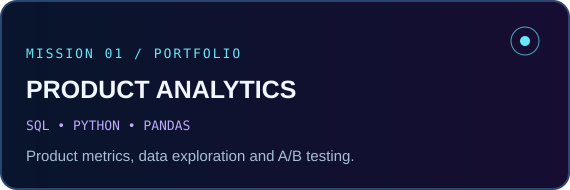
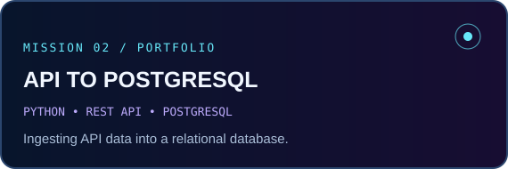
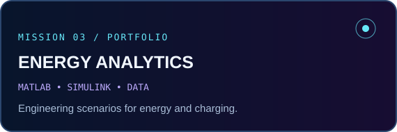
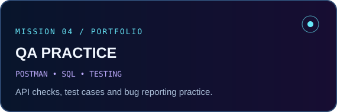

 

 

### `01 // ABOUT THE EXPLORER`

**Hi, I'm Erkenaz.** I'm a 2026 **IT & Power Engineering** graduate from **ALT University**, interested in using data and software to solve engineering problems.

I work with **Python, SQL and PostgreSQL**, and I'm developing projects in **analytics, automation and software testing**. I'm also exploring AI/ML — as a learning direction, not a claim of professional experience.

🎓 **Graduated with honors** &nbsp; · &nbsp; 🌍 **Kazakhstan** &nbsp; · &nbsp; 🚀 **Open to junior opportunities**

 

### `02 // TECHNOLOGY CONSTELLATION`

  

 

### `03 // FEATURED MISSIONS`

 

 

Project write-ups and repository links are being prepared.

 

### `04 // MISSION MILESTONES`

🥉 **Alem Tech Fest 2026 — RoboCup Rescue:** 3rd place  
🥈 **Satbayev International Conference 2026 Hackathon:** 2nd place, Mechanical & Power Engineering  
🎓 **ALT University:** Bachelor's degree with honors

 

### `05 // SIGNALS FROM GITHUB`

 

 

**✦ STAY CURIOUS · KEEP BUILDING · REACH FOR THE STARS ✦**

