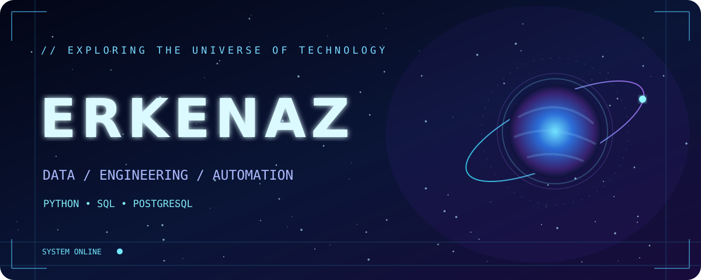
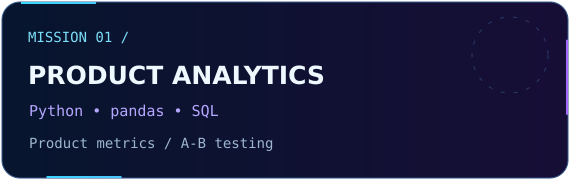
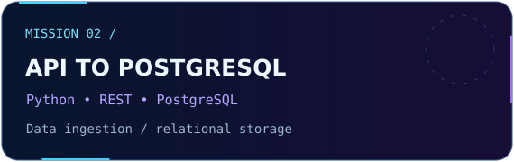
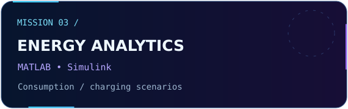
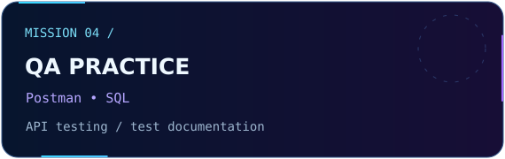

 

## `01 // MISSION CONTROL`

**Hi, I'm Erkenaz** — an **IT & Power Engineering graduate** from **ALT University (2026)**, based in Kazakhstan.

I combine an engineering background with a growing interest in **data analytics, software and automation**. I'm developing hands-on projects using Python, SQL and PostgreSQL, while exploring QA and AI/ML.

**Focus:** Data Analytics · Python · SQL · Engineering · Automation

## `02 // TECH UNIVERSE`

  

## `03 // SELECTED MISSIONS`

<table><tr><td width="50%"></td><td width="50%"></td></tr><tr><td width="50%"></td><td width="50%"></td></tr></table>

*Portfolio documentation and project links are being prepared.*

## `04 // MILESTONES`

🥉 **3rd place** — Alem Tech Fest 2026, RoboCup Rescue  
🥈 **2nd place** — Satbayev International Conference 2026 Hackathon (Mechanical & Power Engineering)  
🎓 **Graduated with honors** — ALT University, 2026

## `05 // LIVE TELEMETRY`

**✦ STAY CURIOUS · KEEP BUILDING · REACH FOR THE STARS ✦**

