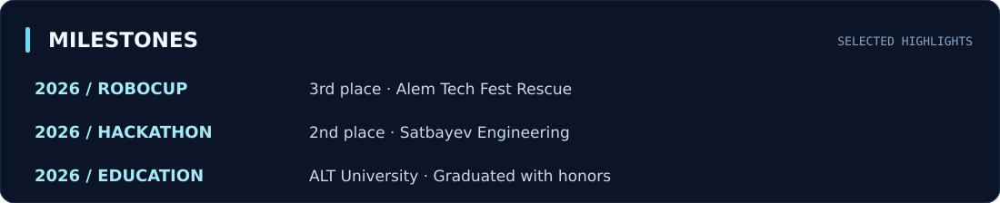

 

 

 

### 01 / ABOUT

I'm **Erkenaz**, an **IT & Power Engineering graduate** from ALT University (2026), based in Kazakhstan. I work on practical projects involving **Python, SQL, PostgreSQL and engineering data**, and I'm exploring analytics, software testing and automation.

**Currently focused on:** Data Analytics · Python · SQL · Portfolio Projects

### 02 / TOOLKIT

  

### 03 / SELECTED WORK

| Project | What I'm working on | Stack |
|:--|:--|:--|
| **Product Analytics** | Product metrics, SQL analysis and A/B testing | Python · pandas · PostgreSQL |
| **API → PostgreSQL** | Data ingestion from REST APIs into a relational database | Python · REST · SQL |
| **Energy Analytics** | Energy and charging-infrastructure modelling | MATLAB · Simulink |
| **QA Practice** | Test cases and API testing exercises | Postman · SQL |

> Project documentation and repository links are being refined.

### 04 / MILESTONES

### 05 / GITHUB ACTIVITY

---

BUILD · LEARN · IMPROVE

